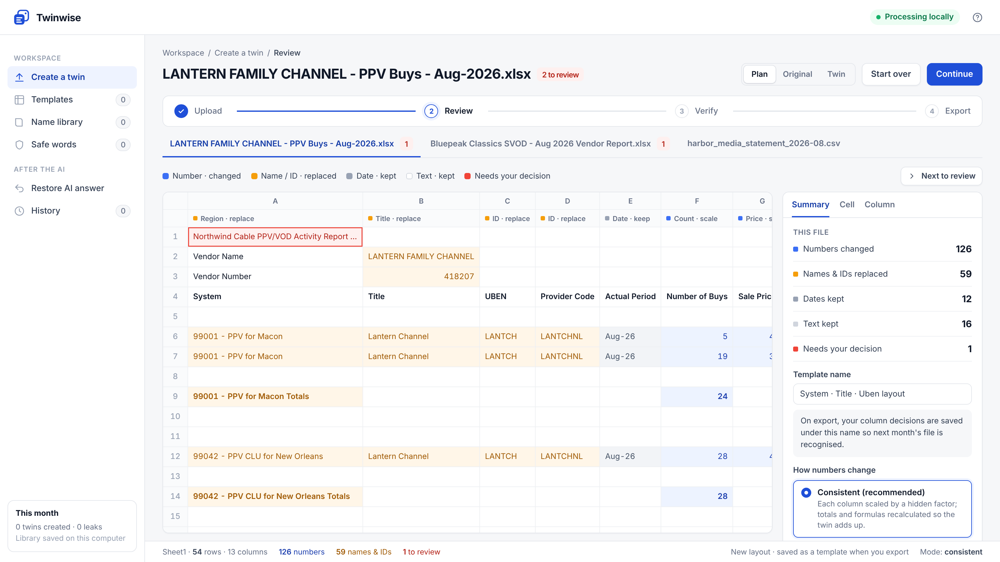
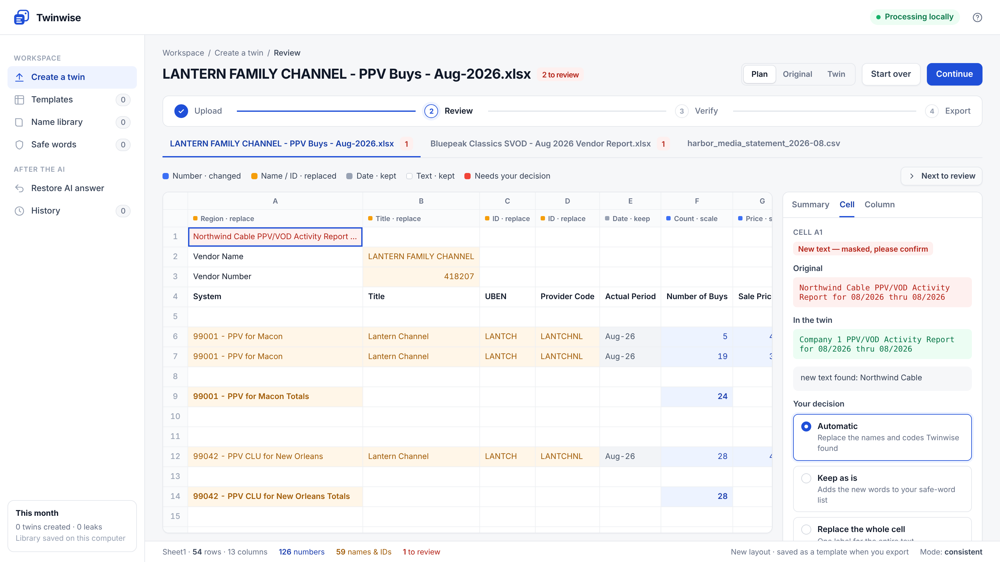
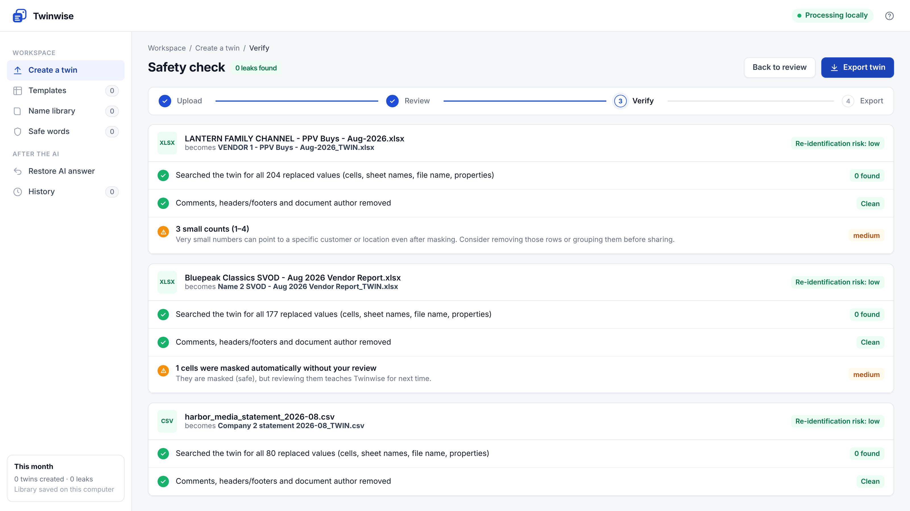
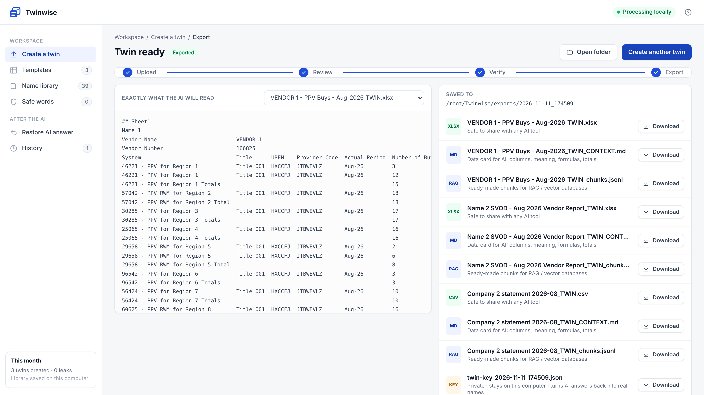

<p align="center"></p>

<h1 align="center">Twinwise</h1>
<p align="center"><b>Make a safe twin of your business spreadsheets before you use AI.</b><br>
Same layout. Fake names, IDs and numbers. Totals still add up. Runs entirely on your computer.</p>



<p align="center">🎬 <a href="docs/Twinwise_User_Guide.mp4"><b>Watch the 98-second user guide</b></a> · 📘 <a href="docs/USER_GUIDE.md"><b>User guide</b></a> · 📕 <a href="docs/USER_MANUAL.md"><b>User manual</b></a> · ⬇️ <a href="https://github.com/Chalkduggo/Twinwise/releases/latest"><b>Download for Windows · macOS · Linux</b></a></p>

## The problem

Teams want to ask ChatGPT, Claude or Copilot about their partner reports, revenue statements and subscriber files, but they can't upload the real thing. Partner names, deal terms and figures are confidential.

Twinwise creates a **data twin**: a copy of the file that looks and behaves like the original, with everything sensitive replaced.

| Original | Twin |
|---|---|
| `Northwind Cable PPV/VOD Activity Report` | `Company 1 PPV/VOD Activity Report` |
| `99001 - PPV for Macon` | `79224 - PPV for Region 1` |
| `LANTERN FAMILY CHANNEL`, vendor `418207` | `VENDOR 1`, vendor `187512` |
| 5 buys × 4.99 = 24.95 | 7 buys × 3.99 = 27.93 *(still adds up)* |
| `royalties@harbormedia.example` | `user1@example.com` |

## How it works

1. **Drop in files.** Excel (`.xlsx`), CSV, or a ZIP of them.
2. **Automatic first pass.** Twinwise finds the header row, works out what each column holds (names, IDs, counts, prices, percentages, dates), spots totals rows and formulas such as *Revenue = Buys × Price*, and plans every change.
3. **You review.** Colours show the plan. Anything new it isn't sure about is marked in red. Click a cell or a column to change how it's handled.
4. **Safety check.** The saved twin is searched for every value that was replaced: cells, sheet names, file name and document properties. Export is blocked if anything is found.
5. **Export and use.** You get the twin (safe to share) and a private **key file** (never share it). Paste the AI's answer into *Restore AI answer* to see real names again.

Every export also includes **AI-ready context** for chat or RAG pipelines:

- `…_CONTEXT.md`: a data card covering what the file is, what each column means, the formulas in plain words (*Revenue = Number of Buys × Sale Price*), totals and summary figures. Paste it into a chat next to the twin, or index it.
- `…_chunks.jsonl`: ready-made chunks (overview, columns, totals, one per row) with metadata such as file, sheet, row and name labels. Load them straight into LangChain, LlamaIndex, Azure AI Search, pgvector, or anything that takes JSON lines.

Both are built from the twin only and pass the same leak test, so nothing real reaches your vector database.

Twinwise **learns**. Your decisions are saved as templates and a name library, so next month's file from the same partner is recognised and needs no review.

| Review | Safety check | Export |
|---|---|---|
|  |  |  |

## Install

**Download the app** from [Releases](https://github.com/Chalkduggo/Twinwise/releases/latest). No Python needed:

| System | File | Start it |
|---|---|---|
| Windows 10/11 | `Twinwise-Windows.zip` | Unzip, double-click `Twinwise.exe`. If you see *"Windows protected your PC"*, click **More info → Run anyway**. |
| macOS (Apple Silicon) | `Twinwise-macOS-AppleSilicon.zip` | Unzip, double-click `Start Twinwise.command`. If macOS blocks it, go to **System Settings → Privacy & Security → Open Anyway**. |
| Linux (x86-64) | `Twinwise-Linux-x86_64.tar.gz` | `tar -xzf …` then `./Twinwise/start-twinwise.sh` |

The apps aren't code-signed yet, which is why the operating system asks once. Intel Macs: use the Python install below.

**With Python 3.10 or newer:**

```bash
git clone https://github.com/Chalkduggo/Twinwise.git
cd Twinwise
pip install -e .
twinwise ui          # opens http://127.0.0.1:8765 in your browser
```

From source, double-click **`Start-Twinwise.bat`** (Windows) or run **`./start-twinwise.sh`** (macOS/Linux). Either one creates a private Python environment the first time, then opens the app.

To try it without your own files:

```bash
twinwise demo        # writes made-up partner reports to ~/Twinwise/demo
```

## Command line

```bash
twinwise twin report.xlsx statements.zip -o out/          # create twins
twinwise twin data.csv --mode scale                       # one hidden factor for everything
twinwise restore --key out/twin-key_2026-11-09.json answer.txt   # AI answer -> real names
```

Exit code `2` means the safety check found a leak, so you can use it in scripts.

## How numbers change

| Mode | What happens | Use when |
|---|---|---|
| **consistent** (default) | Each column is multiplied by its own hidden factor. Formulas (×, −, +, average, max) and totals rows are recalculated so the twin adds up exactly. Counts stay whole numbers; prices can be rounded to real price points (3.64 → 3.99). | You want the AI to reason about the data |
| **scale** | Every amount is multiplied by one hidden factor. All ratios stay exact. | You need exact ratios between columns |
| **random** | Each number gets independent noise. | Maximum privacy; totals won't add up |

Hidden factors stay the same from month to month by default, so trends (+8% vs last month) are still meaningful. You can turn this off.

No masked number keeps its real value. Small values are nudged so a "1" never stays "1".

## What it detects

- **Names in name columns** (Partner, Vendor, Channel, Title, Region, City, State, System, Person, Email…). The whole value is replaced, consistently across all files.
- **IDs and codes** (Vendor Number, System ID, UBEN, Provider Code…). Replaced with a fake that keeps the same shape (`E000105-12` → `B227380-03`).
- **Names inside text** (titles, notes, addresses, signatures). Capitalised words that aren't ordinary business words are replaced, company suffixes join the name (*Northwind Communications*), and digit runs are replaced. New finds are flagged for review.
- **Emails and URLs.**
- **Multi-row headers, key-value blocks** above tables (`Vendor Name: …`), totals rows and calculated columns.
- **Hidden extras.** Comments, headers/footers, author and company properties are removed, and sheet names and the file name are masked too.

## Your library (all local)

Everything Twinwise learns lives in `~/.twinwise` (set `TWINWISE_HOME` to change it):

```
safe_words.txt     words you marked as safe
names.json         real name -> fake label
ids.json           real ID -> fake ID
factors.json       hidden factors per column (for month-to-month comparisons)
templates/         one JSON file per report layout, with your column rules
history.jsonl      a local log of every exported twin
```

These are plain text files, so you can back them up or share templates with a teammate by hand.

## Safety model, and its limits

Twinwise is built so that mistakes lean towards **over-masking**. Unknown text is masked and shown to you, not kept.

Please know what it does **not** guarantee:

- The leak test proves that everything Twinwise replaced is gone. It can't prove that text it judged safe isn't sensitive to you. The *Kept text you may want to glance at* list and the red review cells exist for that.
- Formulas are kept as formulas. Excel recalculates them from the masked inputs, and cached results are not stored.
- Very small groups (a count of 1 in a small town) can still hint at a real customer. Twinwise warns you about these.
- `.xls`, PDF and images aren't supported yet.
- The key file contains the real values. Keep it private.

## Privacy

- The server listens only on `127.0.0.1` and rejects requests from any other host.
- There's no telemetry, no analytics and no network calls. Your files never leave your computer.
- Test and demo data in this repo is fictional.

## Roadmap

Free and open source (this repo): everything above.

Planned paid add-ons (separate, optional):

- Smart Assist (local AI through Ollama to classify unknown text)
- Ready-made template packs
- Batch and watched folders
- Realistic fake company names
- Advanced re-identification scoring
- PDF statements
- Team sharing with approvals and single sign-on

## Building the apps

Push a tag like `v0.2.0`. `.github/workflows/release.yml` runs the tests on Windows, macOS and Linux, builds a single-file app on each with PyInstaller, starts it as a smoke test, and attaches all three downloads to the release.

## Development

```bash
pip install -e ".[dev]"
pytest
```

The code is small and readable:

| File | What it does |
|---|---|
| `analyze.py` | Understands a sheet: header row, column roles, totals, formulas |
| `textmask.py` | Masks names and codes inside text |
| `twin.py` | Builds the twin and recalculates numbers |
| `verify.py` | Leak test and risk warnings |
| `keyfile.py` | Key file and restore |
| `rag.py` | AI context data card and RAG chunks |
| `engine.py` | Jobs, templates, export |
| `server.py`, `ui/` | Local review screen (no build step) |

## License

Apache License 2.0. See [LICENSE](LICENSE).

Twinwise is developed and maintained by **LoopWise**, created by **Suman Mondal**.
