# Twinwise user guide

Twinwise makes a **data twin** of a spreadsheet: the same layout, with names, IDs and numbers replaced, so you can share it with an AI tool without exposing real data. Everything runs on your own computer.

🎬 Prefer video? Watch the [98-second user guide](Twinwise_User_Guide.mp4).

---

## 1. Start Twinwise

| You have | Do this |
|---|---|
| **Windows, no Python** | Download `Twinwise.exe` from the [Releases page](https://github.com/Chalkduggo/Twinwise/releases) and double-click it. If Windows shows *"Windows protected your PC"*, click **More info → Run anyway** (the app isn't code-signed yet). |
| **Windows with Python 3.10+** | Download the code and double-click `Start-Twinwise.bat`. |
| **Mac / Linux / developers** | `pip install -e .` then `twinwise ui` |

Your browser opens at `http://127.0.0.1:8765`. This address only works on your own computer. Keep the black window open while you work, and close it to stop Twinwise.

## 2. Drop in your files

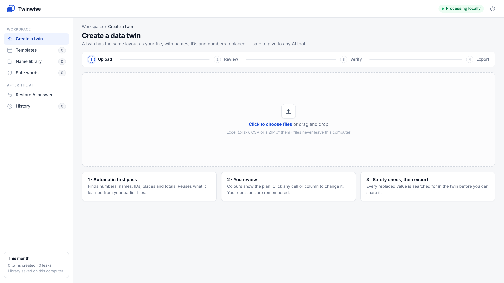

Drag in Excel (`.xlsx`), CSV, or a ZIP of them. Several files at once is fine, and names stay consistent across all of them.

## 3. Read the plan

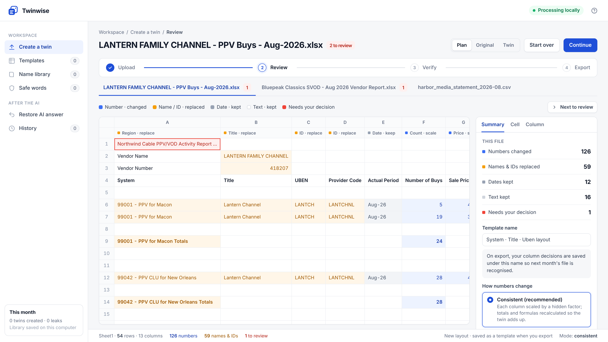

| Colour | Meaning |
|---|---|
| 🔵 Blue | Number, will be changed |
| 🟠 Amber | Name or ID, will be replaced |
| ⚪ Grey | Date, kept |
| White | Ordinary text, kept |
| 🔴 Red | New text Twinwise hasn't seen before. It's masked until you decide |

The row under the column letters shows what each column was recognised as (*Region · replace*, *Count · scale*, *Formula · recalc*…).


## 4. Decide on anything new

Click **Next to review** (or any cell). The **Cell** panel shows the original value, the twin value and three choices:


- **Automatic**: replace the names and codes Twinwise found
- **Keep as is**: the words are added to your safe-word list
- **Replace the whole cell**: one label for the entire text

Your decision is remembered for next time.

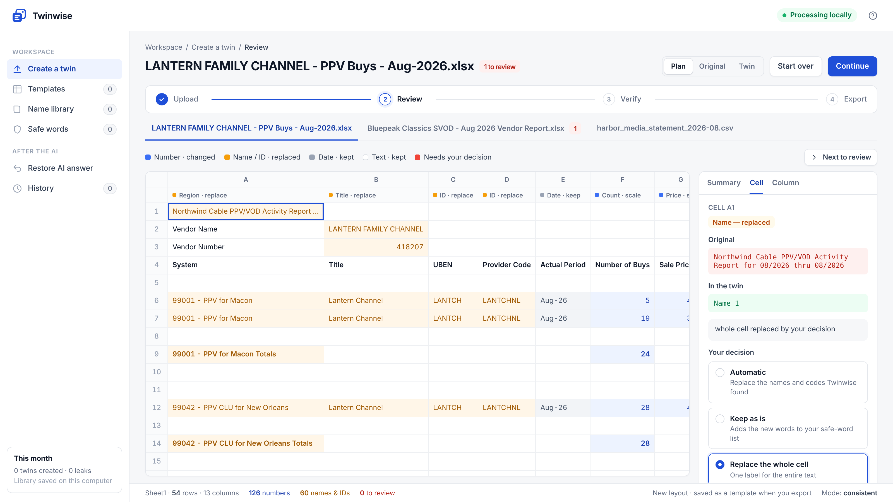

## 5. Change a whole column (optional)

Click a column letter. You can say what the column holds, keep public data unchanged, or turn price rounding on or off.

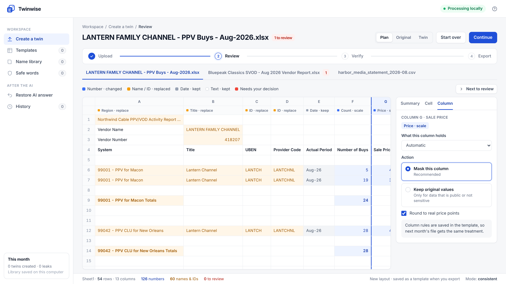

## 6. Choose how numbers change

In **Summary**:

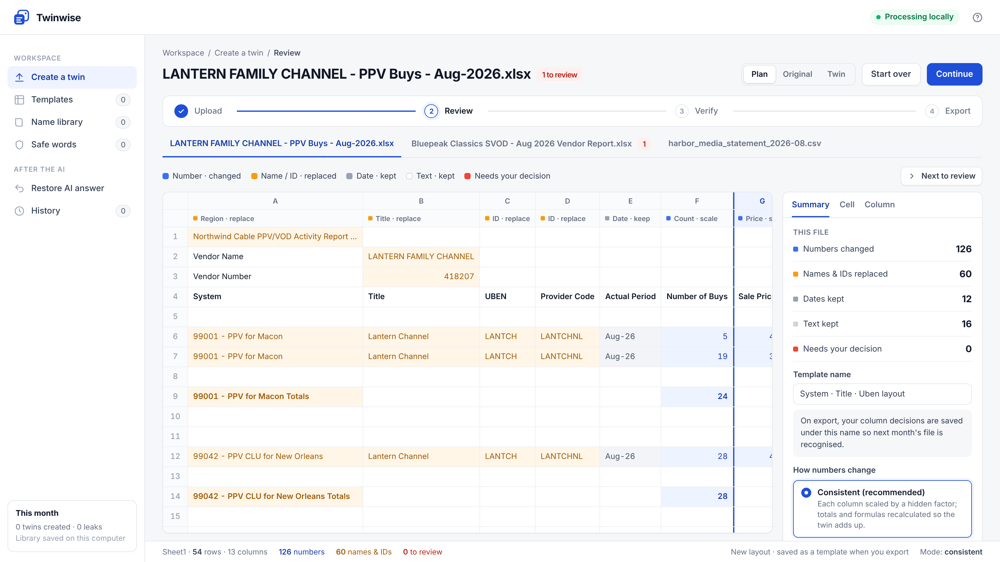

- **Consistent** (recommended): each column gets its own hidden factor, and totals and formulas are recalculated, so the twin adds up.
- **One hidden factor**: every amount is multiplied by the same factor.
- **Random**: independent noise. Most private, but totals won't add up.

## 7. Compare original and twin

Use **Plan / Original / Twin** at the top right.

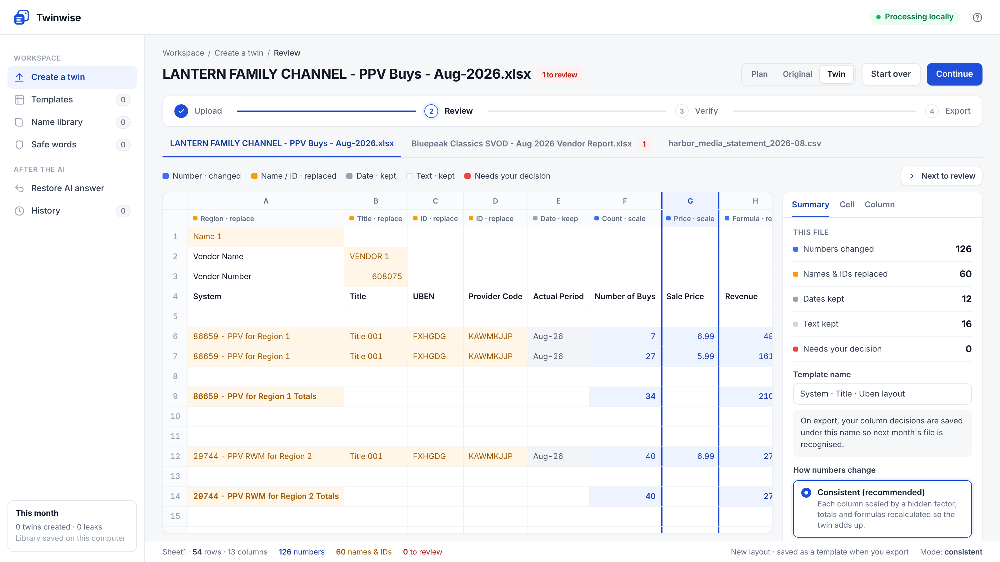

## 8. Safety check

Click **Continue**. Twinwise saves the twin and searches it for every value it replaced: cells, sheet names, file name and document properties. If anything is found, export is blocked.

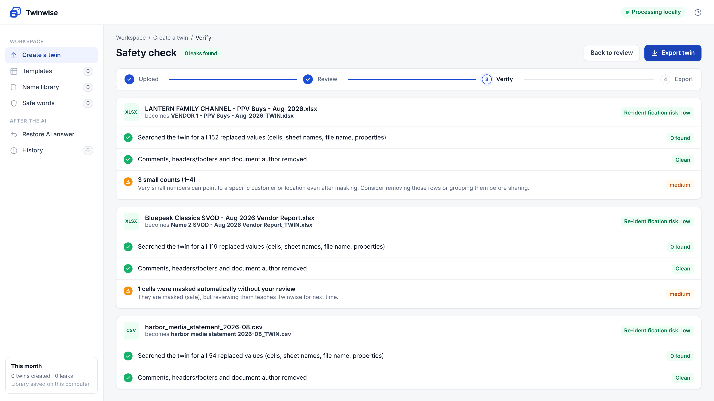

Warnings such as *small counts* or *kept text you may want to glance at* are there to help you decide. They don't block export.

## 9. Export

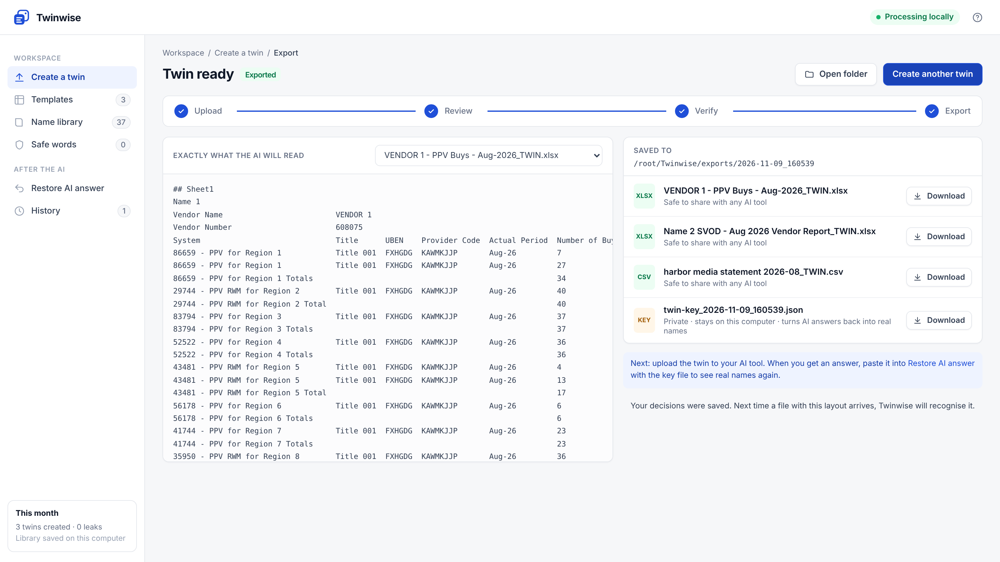

You get:

- **The twin** (`…_TWIN.xlsx` / `.csv`). Upload this to ChatGPT, Claude, Copilot or any other AI tool.
- **The key file** (`twin-key_….json`). **Private.** Never upload or share it.
- A report of the checks (`twin-report_….json`)

Files are saved in `Documents\..\Twinwise\exports` (your home folder → `Twinwise\exports`).

## 10. Bring the AI's answer back

Open **Restore AI answer**, choose the key file and paste the AI's answer. Fake names become real again.

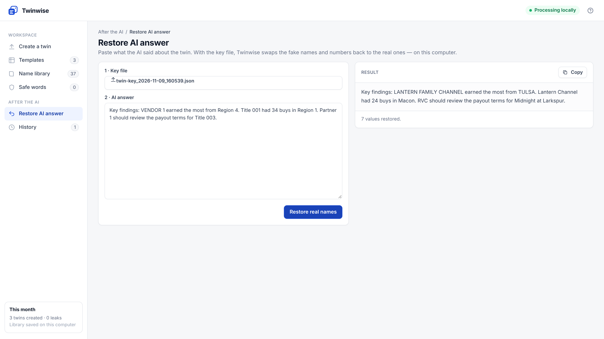

Numbers that appear in the twin are mapped back exactly. Numbers the AI calculated itself (sums, averages, growth) can't be mapped back exactly. Percent changes and rankings stay valid in Consistent mode.

## 11. Next month

Drop in next month's file from the same partner. Twinwise recognises the layout, applies your rules and reuses the same fake names. Usually there's nothing to review.

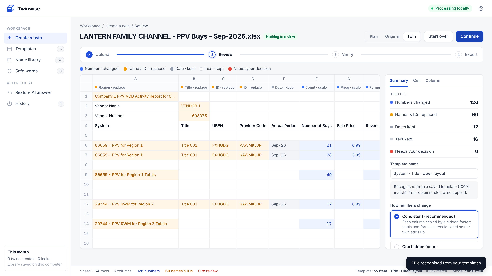

## 12. Your library

Everything Twinwise learns is stored on your computer in `.twinwise` in your home folder:

- **Templates**: one per report layout, with your column rules
- **Name library**: real name → fake label (add, edit or mark safe)
- **Safe words**: text that's never masked
- **History**: a local record of every export

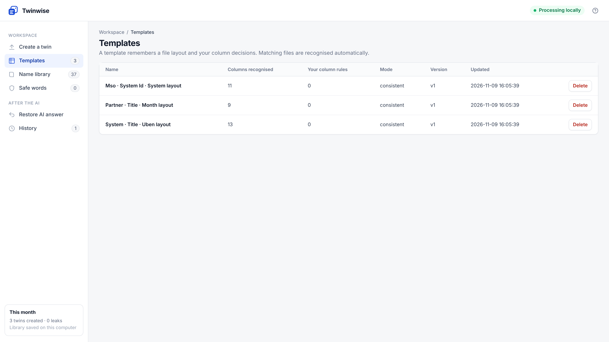
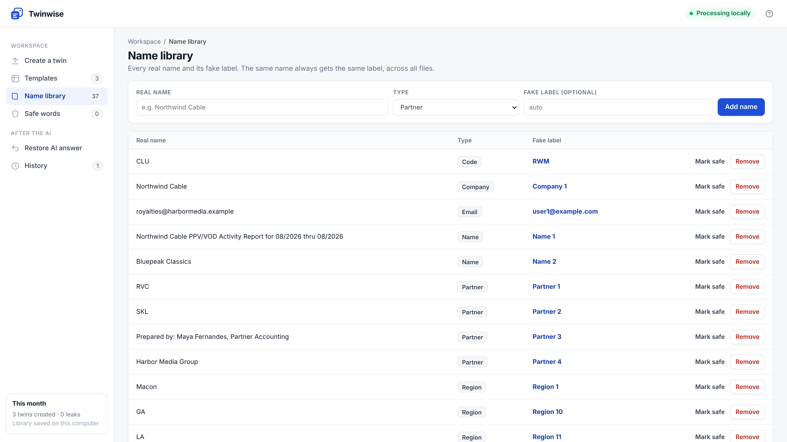

---

## Tips

- Review red cells the first time you use a new layout. It takes a minute and makes every later month automatic.
- Keep the key file next to the twin, but never upload it.
- Small counts (1–4) can still point to a real customer. Group or remove those rows if that matters.
- To start fresh, delete the `.twinwise` folder in your home directory.

## Command line (optional)

```bash
twinwise twin "Partner report.xlsx" -o out/
twinwise restore --key out/twin-key_2026-11-09.json answer.txt
twinwise demo
```
