# Twinwise User Manual

**Version 0.3.0** · Developed and maintained by LoopWise · Created by Suman Mondal

This manual is the complete reference for Twinwise. For a quick start, see the [User Guide](USER_GUIDE.md) or the 98-second video.

---

## Contents

1. What Twinwise is
2. Installing and starting
3. The screen at a glance
4. Creating a twin, step by step
5. How Twinwise reads a file
6. What gets masked, and how
7. How numbers change
8. Reviewing: cell and column decisions
9. The safety check
10. What you get when you export
11. Using the twin with AI tools
12. Using the twin in a RAG pipeline
13. Restoring an AI answer
14. Templates and the library
15. Command line reference
16. Privacy and security
17. Limits you should know
18. Troubleshooting
19. Frequently asked questions
20. Glossary

---

## 1. What Twinwise is

Twinwise makes a **data twin** of a spreadsheet: a copy with the same layout, where every name, ID and number is replaced. The twin still behaves like the original. Totals add up, formulas hold, and comparisons inside a column stay meaningful. That means you can give it to ChatGPT, Claude, Copilot or a RAG pipeline and get useful answers without exposing real data.

Three principles guide every design decision:

| Principle | What it means in practice |
|---|---|
| **Local only** | Everything runs on your computer. No uploads, no cloud, no telemetry. |
| **Fail safe** | Text Twinwise doesn't recognise is masked first, then shown to you. It never quietly keeps something it isn't sure about. |
| **You decide** | Rules and your review decide what is masked. No AI model makes masking decisions. |

---

## 2. Installing and starting

### 2.1 Download the app (no Python needed)

Get the file for your computer from the **Releases** page: `github.com/Chalkduggo/Twinwise/releases/latest`.

| System | File | How to start |
|---|---|---|
| Windows 10 / 11 | `Twinwise-Windows.zip` | Unzip, then double-click `Twinwise.exe` |
| macOS, Apple Silicon (M1 and later) | `Twinwise-macOS-AppleSilicon.zip` | Unzip, then double-click `Start Twinwise.command` |
| Linux, x86-64 | `Twinwise-Linux-x86_64.tar.gz` | `tar -xzf Twinwise-Linux-x86_64.tar.gz`, then `./Twinwise/start-twinwise.sh` |

**First-run security prompts.** The apps aren't code-signed yet, so the operating system asks once:

- **Windows:** *"Windows protected your PC"* → **More info → Run anyway**.
- **macOS:** *"cannot be opened because the developer cannot be verified"* → **System Settings → Privacy & Security** → scroll down → **Open Anyway**. Or right-click the file → **Open → Open**.

### 2.2 Run from source (any system with Python 3.10+)

```bash
git clone https://github.com/Chalkduggo/Twinwise.git
cd Twinwise
pip install -e .
twinwise ui
```

Or double-click `Start-Twinwise.bat` (Windows), or run `./start-twinwise.sh` (macOS/Linux). These create a private Python environment the first time.

### 2.3 Starting and stopping

Starting Twinwise opens your browser at `http://127.0.0.1:8765`. A small terminal window stays open while it runs.

- **To stop Twinwise**, close that window (or press `Ctrl + C` in it).
- **Port already in use?** Run `twinwise ui --port 8780`.

---

## 3. The screen at a glance


| Area | What it does |
|---|---|
| **Top bar** | Logo and the *Processing locally* badge |
| **Left menu** | *Create a twin*, *Templates*, *Name library*, *Safe words*, *Restore AI answer*, *History* |
| **Steps bar** | Upload → Review → Verify → Export |
| **Grid** | Your sheet, colour-coded |
| **Inspector** (right) | *Summary*, *Cell* and *Column* tabs |
| **Status bar** (bottom) | Rows, counts, template match and mode |

**Colour key**

| Colour | Meaning |
|---|---|
| Blue | Number, will be changed |
| Amber | Name or ID, will be replaced |
| Grey | Date or period, kept |
| White | Ordinary text, kept |
| Red outline | New text Twinwise hasn't seen before. It's masked until you decide |

---

## 4. Creating a twin, step by step

1. **Upload.** Drag files onto *Create a twin*, or click to choose. Accepted: `.xlsx`, `.xlsm`, `.csv`, `.tsv` and `.zip` files containing them. Several files can be processed together, and names stay consistent across all of them.
2. **Review.** Check the plan. Use **Next to review** to jump through red cells. Change cells or columns if needed (see section 8).
3. **Verify.** Click **Continue**. Twinwise saves the twin and runs the safety check (section 9).
4. **Export.** Click **Export twin**. Files are saved and can be downloaded (section 10).

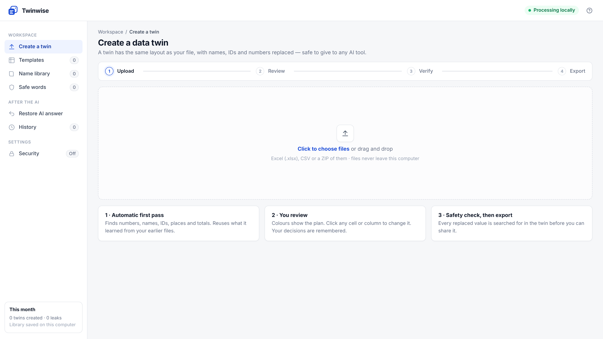

---

## 5. How Twinwise reads a file

Before changing anything, Twinwise analyses each sheet.

| It finds | How |
|---|---|
| **Header row(s)** | The row that best describes the columns below it, including two-row headers (e.g. "Beginning" above "Subs") |
| **Report details** above the table | Label–value pairs such as `Vendor Name: …`, `Vendor Number: …` |
| **Column roles** | From the header and the values: name, ID/code, count, price/rate, percentage, amount, date, text |
| **Totals rows** | Rows containing *Total*, *Totals*, *Grand Total* or *Subtotal*, checked against the rows above |
| **Calculated columns** | Columns equal to A × B, A × B ÷ 100, A − B, A + B, the average of A and B, or the larger of A and B, checked row by row |
| **Small label rows** inside a table | E.g. `Adjustments: | Month | Year | Amount`, so they aren't mistaken for data |

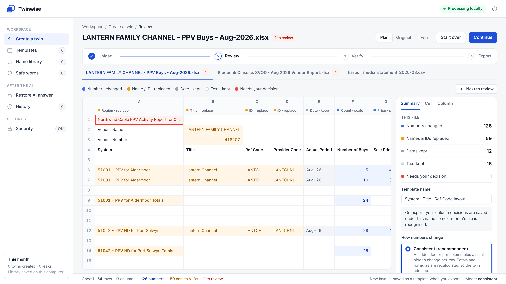

The second header row in the grid shows what was found for each column, for example *Region · replace*, *Count · scale* or *Formula · recalc*.

---

## 6. What gets masked, and how

| Data | Example | Becomes |
|---|---|---|
| Names in name columns (Partner, Vendor, Channel, Title, City, State, System, Person…) | `Lantern Channel` | `Title 001` |
| Codes inside names | `51126 - PPV HD for Port Selwyn` | `10002 - PPV RWM for Region 2` |
| IDs and codes (Vendor Number, System ID, Ref Code, Provider Code…) | `E000105-12` | `B227380-03` (same shape) |
| Names inside headings and notes | `Northwind Cable PPV Activity Report` | `Company 1 PPV Activity Report` |
| People and signatures | `Prepared by: Maya Fernandes` | `Prepared by: Name 4` |
| Emails, web links | `royalties@harbor…` | `user1@example.com` |
| State codes | `OR`, `IN`, `CO` | `REGION 7` |
| File and sheet names | `harbor_media_statement.csv` | `Company 1 statement_TWIN.csv` |
| Comments, headers/footers, author and company properties | | Removed |

**Consistency.** The same real name always gets the same label, in every file and every month, because labels are stored in your name library.

**Kept on purpose.** Ordinary business words (Revenue, Total, Subscribers…), industry terms (SVOD, AVOD, PPV…), months, years, dates, and numbers with one or two digits inside text.

---

## 7. How numbers change

Pick the mode in **Summary → How numbers change**.

| Mode | What happens | Totals add up? | Best for |
|---|---|---|---|
| **Consistent** (default) | Each column is multiplied by its own hidden factor and each row by a small hidden variation. Calculated columns and totals are then recalculated from the masked values. | Yes, exactly | Asking AI to analyse the data |
| **One hidden factor** | Every amount is multiplied by the same factor. One known real figure reveals all the others. | Yes | When ratios must stay exact and the reader knows none of the real figures |
| **Random** | Each number gets independent noise. | No | Maximum privacy, layout-only questions |

**Details:**

- **Counts** stay whole numbers. A real count is never left unchanged; even a "1" becomes something else.
- **Prices** can be rounded to real price points (3.64 → 3.99). Turn this on or off in *Summary*, or per column.
- **Percentages** change gently and stay between 0 and 100.
- **Number formats are kept**: `$1,234.56`, `55%`, `(120.00)`.
- **Stable factors** (on by default): the same column gets the same hidden factor every month, so month-to-month changes (+8%) stay true. Turn this off for maximum privacy.
- **Row variation** (Consistent mode; Off, ±5% default, ±10%, ±20%): every row gets its own small hidden change on top of the column factor. Without it, anyone who knows one real figure can divide it by the twin figure and work out the whole column.
  - The same row gets the same variation in every count and amount column, so ratios inside a row (revenue per subscriber) stay true.
  - With stable factors on, a row keeps its variation every month, so each row's trend stays true.
  - Prices and percentages vary by value, not by row, so equal prices stay equal.
  - Totals are recalculated after the variation and still add up exactly.
  - Two rows with nearly equal values may swap order. Column totals shift by a little less than the variation.

---

## 8. Reviewing: cell and column decisions

### 8.1 Cell decisions

Click any cell. The **Cell** tab shows the original, the twin value, the reason, and three choices:

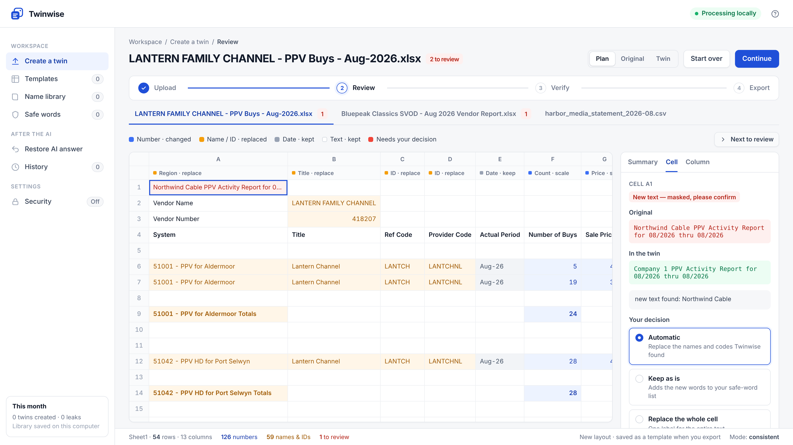

| Choice | Effect | Remembered as |
|---|---|---|
| **Automatic** | Replace the names and codes Twinwise found | — |
| **Keep as is** | Leave the text unchanged | The words are added to your safe-word list |
| **Replace the whole cell** | One label for the entire text | The names inside are added to your name library |

### 8.2 Column decisions

Click a column letter (A, B, C…). In the **Column** tab you can:

- change **what the column holds** (amount, count, price, percent, ID, names with a name type, date, text);
- choose **Keep original values**, only for data that is public or not sensitive;
- turn **price-point rounding** on or off for price columns.

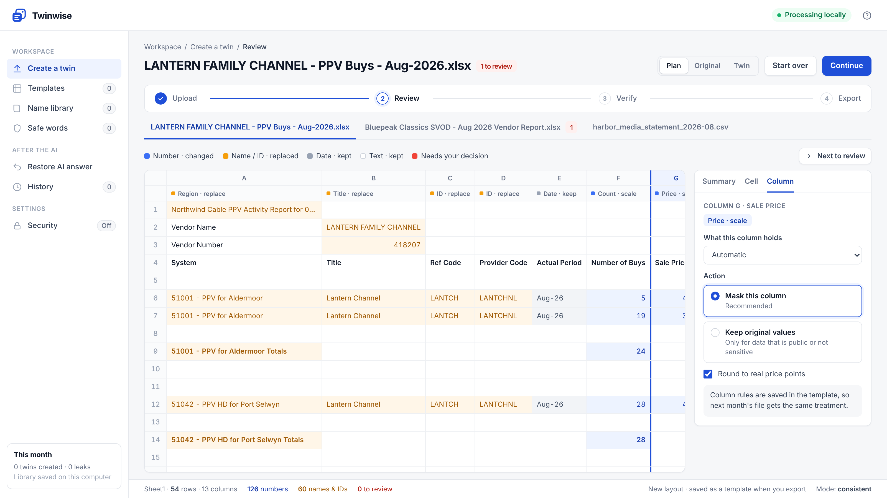

Column decisions are saved in the template, so next month's file is handled the same way.

### 8.3 Views

**Plan** (colours on the original values), **Original** and **Twin**. Switch at the top right.

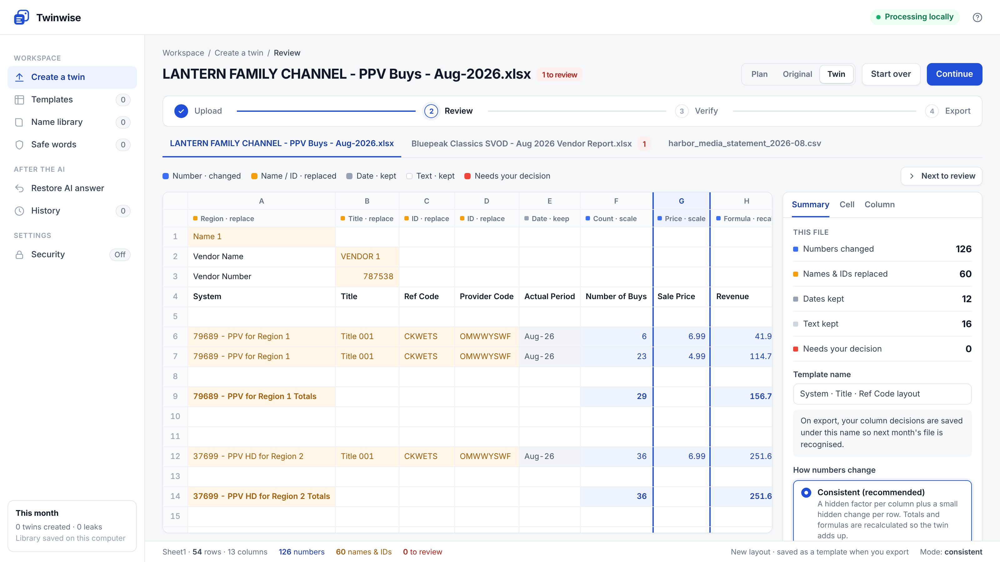

---

## 9. The safety check

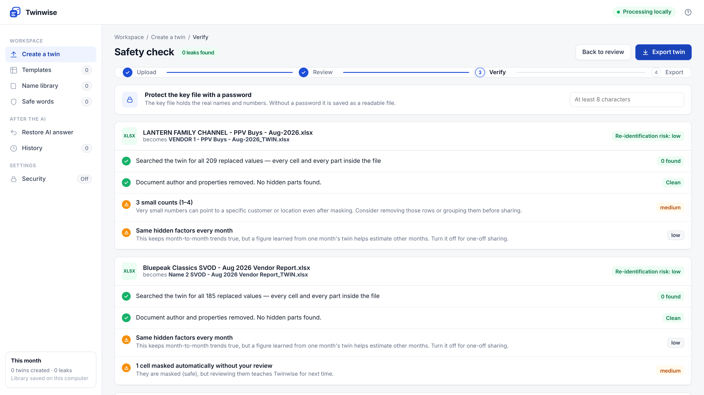

The check runs on the **saved files**, not on the plan.

| Check | Result |
|---|---|
| Every replaced name, ID and code is searched for in all cells, formulas, sheet names, the file name and document properties | Must be **0 found** |
| Every changed number is checked to make sure it doesn't still hold its real value | Must be **0 found** |
| File and sheet names are checked for any word from a replaced name | Must be **0 found** |
| The AI context files (section 10) are searched the same way | Must be **0 found** |
| Every part inside the saved Excel file is searched, including parts you can't see in Excel | Must be **0 found** |
| Pivot tables, charts, images, hyperlinks, comments, drop-down lists, external links, defined names, headers/footers, author details, macros | Removed, and listed under *Removed from the twin* |

If anything is found, **export is blocked** and the exact cell is listed.

**Risk warnings** (they inform you, but don't block export):

- **Small counts (1–4):** very small numbers can point to a specific customer or location.
- **Percentages kept as-is:** contract terms such as a revenue split can identify a deal.
- **Kept text you may want to glance at:** capitalised words that were kept.
- **Cells masked without your review:** they're safe, but reviewing them teaches Twinwise.
- **One hidden factor / row variation off:** one known real figure reveals the others.
- **Same hidden factors every month:** good for trends; turn off for one-off sharing.

**Why parts are removed.** Excel stores a copy of the source data inside every pivot table and the plotted values and labels inside every chart. Images are often logos. Masking the cells does not change these copies, so Twinwise removes them. Macro-enabled files (`.xlsm`) are saved as `.xlsx` twins without the macros. If you need a chart, rebuild it from the twin.

**Key file password.** The safety check page has a password box for the key file. With a password the key file is encrypted and the report no longer lists the original file names. If library protection is on (section 14.3), that password is used unless you type another.

---

## 10. What you get when you export

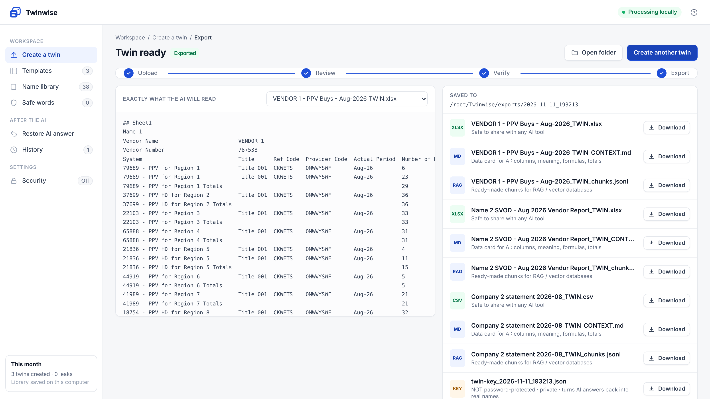

| File | Share? | What it is |
|---|---|---|
| `…_TWIN.xlsx` / `.csv` | ✅ Yes | The twin |
| `…_TWIN_CONTEXT.md` | ✅ Yes | A data card for AI: what each column means, formulas in plain words, totals, summary figures |
| `…_TWIN_chunks.jsonl` | ✅ Yes | Ready-made chunks for RAG / vector databases |
| `twin-key_<date>.json` | ❌ **Never** | Private key linking fake values to real ones. Encrypted if you set a password |
| `twin-report_<date>.json` | Internal | Results of every check, for your records |

The default folder is `Twinwise/exports/<date_time>` in your home folder. Use **Open folder** to go straight there.

---

## 11. Using the twin with AI tools

1. Upload the **twin** and its **CONTEXT.md** to your AI tool.
2. Ask your question in normal words, using the labels: *"Which Region had the highest revenue? How does Title 001 compare with Title 003?"*
3. Copy the answer and restore it (section 13).

**Prompt tip:** start with *"The attached file is a synthetic twin; the attached data card explains each column."* AI tools give better answers when they know the formulas.

---

## 12. Using the twin in a RAG pipeline

`…_chunks.jsonl` has one JSON object per line:

```json
{"id": "VENDOR 1 - PPV Buys - Aug-2026_TWIN.xlsx#s0-r12",
 "type": "row",
 "text": "Sheet1, row 12: System: 34829 - PPV for Region 2; Title: Title 001; Number of Buys: 40; Sale Price: 3.99; Revenue: 159.60; …",
 "metadata": {"file": "…_TWIN.xlsx", "sheet": "Sheet1", "row": 12, "System": "34829 - PPV for Region 2", "Title": "Title 001"}}
```

| `type` | Contains |
|---|---|
| `overview` | File, sheet, size and report details |
| `columns` | Every column, its meaning, a summary, and the formulas between columns |
| `totals` | Totals rows, ten per chunk |
| `row` | One data row with every field |

**Loading it.** Read the file line by line. Embed `text`, and store `id` and `metadata`. It works with LangChain (`JSONLoader` with `json_lines=True`), LlamaIndex, Azure AI Search, pgvector, Chroma, or any tool that accepts JSON lines. The `metadata` fields let you filter by file, sheet or name label.

Because chunks come only from the twin and are leak-tested, **no real value ever reaches your vector database**. Answers come back in labels. Restore them with the key.

---

## 13. Restoring an AI answer

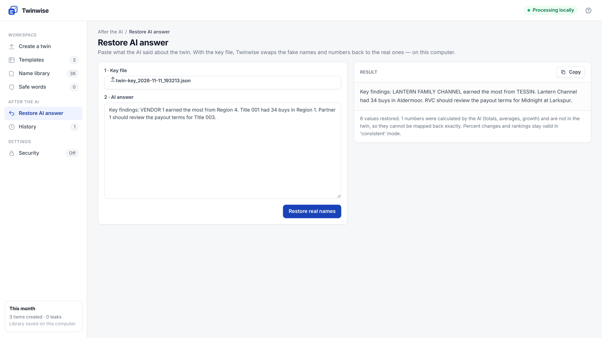

1. Open **Restore AI answer**.
2. Choose the matching `twin-key_….json`. If it is password-protected, a password box appears.
3. Paste the AI's answer, then click **Restore real names**.

| What | Restored? |
|---|---|
| Name labels (`Region 4`, `VENDOR 1`, `Title 001`) | ✅ Always |
| IDs and codes | ✅ Always |
| Numbers that appear in the twin | ✅ Exactly |
| Numbers the AI calculated (sums, averages, growth) | ⚠️ Not exactly. Trends and broad rankings stay valid in Consistent mode; rows with nearly equal values may swap order |

---

## 14. Templates and the library

### 14.1 Templates

A template remembers a report **layout** (its column headers) and **your column decisions**. When a new file matches a saved template closely enough (60% or more of the headers), your rules are applied automatically. You can rename templates in *Summary → Template name*, and delete them from the *Templates* page.

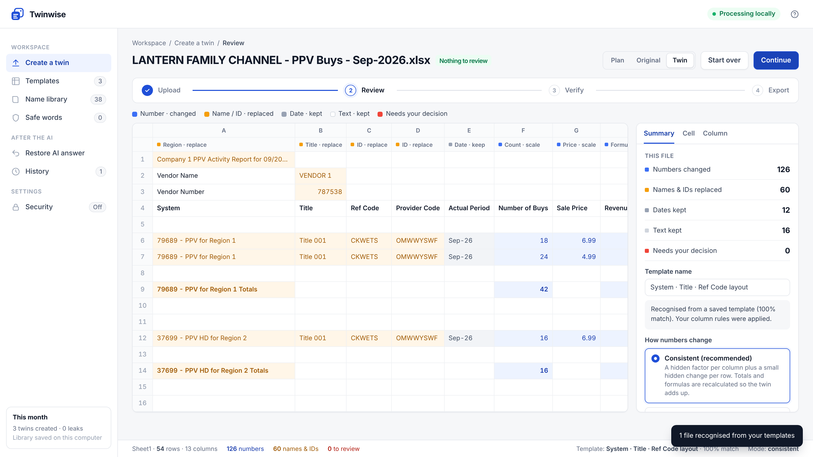

### 14.2 The library

All learning is stored in the `.twinwise` folder in your home directory. You can change the location with the environment variable `TWINWISE_HOME`.

| File | Contents |
|---|---|
| `safe_words.txt` | Words and phrases you marked as safe |
| `names.json` | Real name → fake label, with type |
| `ids.json` | Real ID → fake ID |
| `factors.json` | Hidden factors per column name (for month-to-month comparisons) |
| `templates/*.json` | One file per layout |
| `history.jsonl` | One line per export (local audit trail) |

- **To share templates with a teammate:** copy `templates/` (and `names.json` if you want the same labels). These files contain real names, so share them only inside your team.
- **To reset everything:** close Twinwise and delete the `.twinwise` folder.

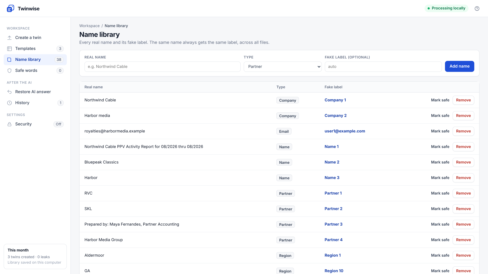

### 14.3 Password protection

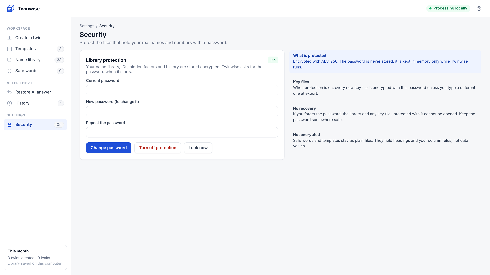

Open **Security** and choose a password of at least 8 characters (a long passphrase is better).

- `names.json`, `ids.json`, `factors.json` and `history.jsonl` are replaced by one encrypted file, `library.enc` (AES-256-GCM; the key is derived from your password with scrypt).
- Twinwise asks for the password each time it starts. **Lock now** locks it without closing.
- New key files are encrypted with the same password unless you type a different one at export.
- You can change the password or turn protection off on the same page; both need the current password.
- Templates and safe words stay as plain files. They hold headings and rules, not data values.
- **There is no recovery.** If the password is lost, delete `library.enc` to start an empty library. Key files encrypted with the lost password cannot be opened.

---

## 15. Command line reference

| Command | Purpose |
|---|---|
| `twinwise ui [--port 8765] [--no-browser]` | Open the review screen |
| `twinwise twin FILES… [-o OUT]` | Create twins without the screen |
| `   --mode consistent \| scale \| random` | How numbers change (default: consistent) |
| `   --no-price-points` | Don't round prices |
| `   --no-stable` | New hidden factors every run |
| `   --no-learn` | Don't save templates or names |
| `   --no-context` | Skip the AI context and RAG files |
| `   --variation 0 \| 0.05 \| 0.1 \| 0.2` | Row variation in consistent mode (default 0.05) |
| `   --key-password PW` | Encrypt the key file (or set `TWINWISE_KEY_PASSWORD`) |
| `twinwise restore --key KEY [--password PW] [FILE]` | Restore an AI answer (reads from stdin if no file is given) |
| `twinwise protect [--off]` | Turn library password protection on or off |
| `twinwise demo [-o DIR]` | Write made-up demo files |

`twinwise twin` exits with code **2** if the safety check finds a leak, so scripts can stop safely. When the library is protected, commands ask for the password, or read it from `TWINWISE_PASSWORD`.

---

## 16. Privacy and security

- The server listens only on `127.0.0.1` and rejects requests whose host isn't this computer.
- There's no telemetry, no analytics and no network calls.
- Uploaded files are copied to a temporary folder for the session. Exports go only where you choose.
- Archives are unpacked safely: paths inside a ZIP are ignored, so a file can't escape the folder.
- The key file and the library contain real values. Turn on password protection (section 14.3) and protect them like the original data.
- Twinwise does pseudonymisation, not anonymisation. The [threat model](THREAT_MODEL.md) lists exactly what a twin does and doesn't protect.

---

## 17. Limits you should know

- The leak test proves that everything Twinwise **replaced** is gone. It can't know that text it judged ordinary is sensitive to you. Glance at the *Kept text* list.
- Formulas in Excel files are kept as formulas. Excel recalculates them from masked inputs, and cached results aren't stored.
- Totals that Twinwise can't link to their rows (for example a subtotal row with no "Total" label) are scaled rather than recalculated.
- Very small groups can still hint at a real customer, even when masked.
- Someone who knows one real figure can estimate others in the same column (to within about ±10% at the default row variation). Someone who knows your business can guess a label from its size.
- Charts, pivot tables and images are removed from the twin, not rebuilt. Dates are kept as they are.
- The review table shows 400 rows at a time; use the arrows or **Next to review** to move.
- Not yet supported: `.xls`, PDF, images, Word documents.
- Downloads are for Windows, Apple Silicon Macs and x86-64 Linux. Intel Macs: run from source.

---

## 18. Troubleshooting

| Problem | Fix |
|---|---|
| The browser didn't open | Go to `http://127.0.0.1:8765` yourself |
| "Address already in use" | Another copy is running: close it, or use `--port 8780` |
| Windows blocks the app | **More info → Run anyway**. Some company laptops block unsigned apps entirely; ask IT, or run from source |
| macOS blocks the app | **System Settings → Privacy & Security → Open Anyway** |
| "Could not read the file" | The file may be password-protected, corrupt or `.xls`. Open it in Excel and save as `.xlsx` |
| Too many red cells | Normal the first time with a new layout. Decide once and Twinwise learns |
| A heading I need was masked | Click it → **Keep as is** (it's added to safe words), or add it on *Safe words* |
| Something sensitive was kept | Click it → **Replace the whole cell**, or set its column to **Names — replace** |
| Export is blocked | Open the listed cell, choose **Replace the whole cell**, and run the check again |
| "This session has expired" | The server was restarted. Upload the files again |

---

## 19. Frequently asked questions

**Does any data go to the internet?** No. Twinwise has no network features at all.

**Can an AI "undo" the twin?** Not from the twin alone. Labels carry no real names, and the hidden factors aren't in the twin. Keep the key file private.

**Why aren't AI models used to decide what to mask?** Predictability. Rules plus your review behave the same way every time, and every decision is visible.

**Will next month's numbers be comparable?** Yes, in Consistent mode with stable factors (the default). The same column keeps the same hidden factor.

**Can my team use it?** Yes. Each person runs it locally. Share templates by copying the `templates` folder.

**Is it free?** Yes. It's open source under the Apache 2.0 licence.

---

## 20. Glossary

| Term | Meaning |
|---|---|
| **Twin** | The masked copy of your file |
| **Label** | A fake name such as *Region 1* or *VENDOR 1* |
| **Hidden factor** | The secret multiplier used to change a column's numbers |
| **Template** | A saved layout plus your column decisions |
| **Safe word** | Text that's never masked |
| **Key file** | Private file linking labels and fake numbers to real ones |
| **Data card** | `CONTEXT.md`, which explains the twin to an AI |
| **Chunk** | One piece of text with metadata, used by RAG pipelines |
| **RAG** | Retrieval-augmented generation: an AI that looks up relevant chunks before answering |

---

*Twinwise is open source under the Apache License 2.0. Source, issues and downloads: github.com/Chalkduggo/Twinwise*
